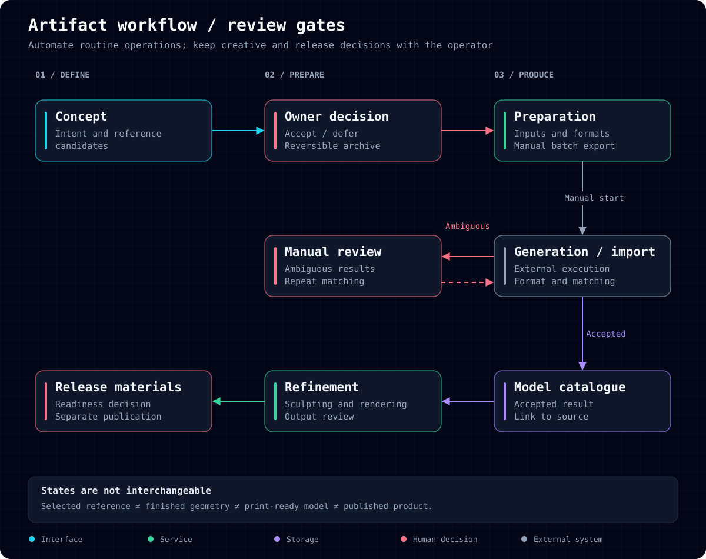
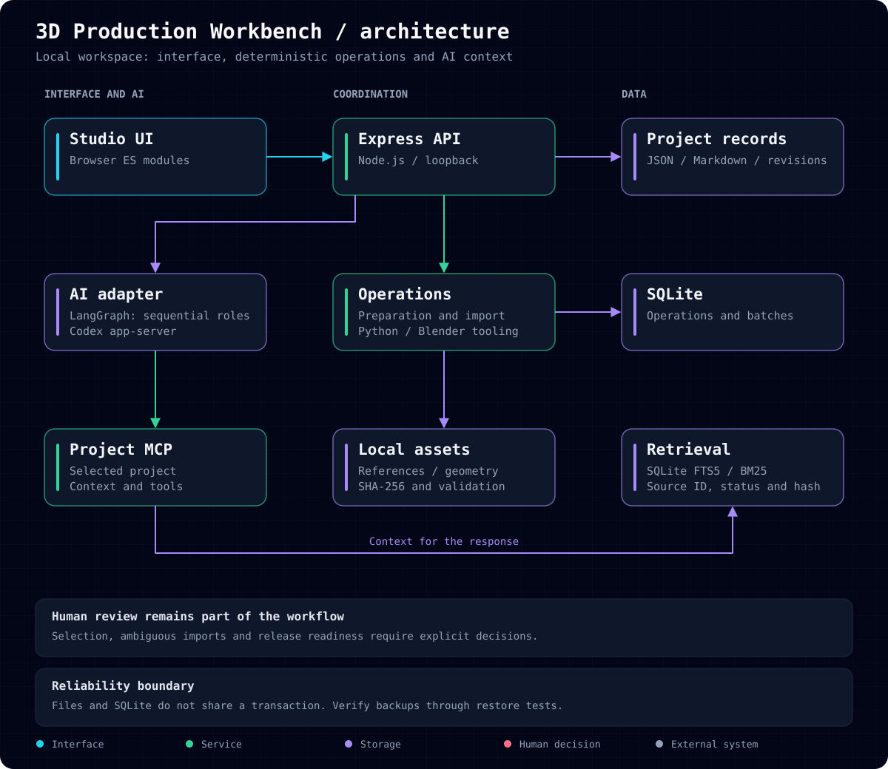
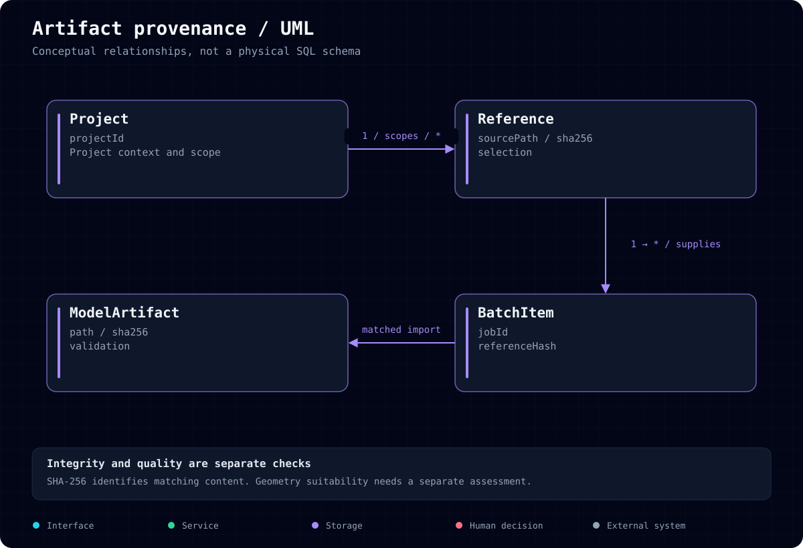

# 3D Production Workbench

English · [Русский](README.md)

**Managing a 3D collection from product lineup and model concept to a prepared production result.**

I develop an internal workspace connecting collection planning, references, generation batches and imported models. The objective is to make material readiness explicit and reduce the need to reconstruct context whenever work switches between tasks.

This case study is anonymized. Production source code and commercial assets remain private. The original problems are reported by the process owner; time losses have not been quantified.

## Why the process needed to change

Production started before the full collection lineup was agreed. Early models were already being processed while later concepts were still taking shape. Late additions were harder to fit into the visual style. Near completion, this meant either adding less compelling models to reach the intended volume or removing work that had already been prepared.

Allocation across product sets was also not consistently planned upfront. The free trial set could be selected after production decisions had narrowed the options. A planned introduction to the product became a selection from whatever was available.

The issue was not only geometry creation speed. Late decisions and unclear input readiness created additional rework.

## Where effort was lost

The path from idea to model includes defining its role in a set, developing visual alternatives, reviewing style and construction, preparing a reference for 3D, obtaining geometry, matching the result and refining the model.

“Reference ready” could mean a concept, an image requiring structural or plausibility changes, or an input suitable for 3D preparation. While some images were being refined, others had no clear next action.

**The organizational constraint:** collection composition, creative selection and technical readiness were not sufficiently explicit. This made planning harder and required repeated checks of the same materials.

## Solution approach

| Problem | Workflow change | Implemented support |
| --- | --- | --- |
| Individual production precedes the overall plan | Review the collection as a whole and record decisions | Project documents and revisions |
| Concepts look like prepared inputs | Separate selection from technical preparation | Selection, archiving and preparation stages |
| Reference-to-model links are lost | Preserve artifact provenance | Batch identifiers, hashes and import matching |
| Ambiguous output moves forward | Return it for review | Manual resolution and file validation |
| Context must be rebuilt | Keep documents and assets within project scope | Local storage, MCP and retrieval |

Early set allocation, free trial selection and collection completeness checks are the next product step. Automatic assortment optimization is not presented as an implemented feature.

## Production workflow

The application automates file preparation, batch structure and format validation. Creative selection, ambiguous imports and release readiness remain operator decisions.

## Technical implementation

The active UI uses browser ES modules with Node.js and Express. JSON/Markdown store project documents; SQLite handles operations and batches. Python and Blender tooling support preparation and cataloguing. Large assets remain local.

AI supports context handling, drafting and review through Codex, MCP and sequential LangGraph roles. FTS5/BM25 provides document retrieval. Deterministic code validates file integrity.

Expected-revision checks prevent stale screens from silently overwriting newer decisions. SHA-256 identifies file contents; it does not establish artistic quality or print readiness.

## Results and evaluation

The source snapshot implements project records, revisions, reference selection and archiving, batch preparation, a catalogue and import checks. Intermediate states and relationships between materials are represented explicitly.

The next success criteria are fewer preparation loops and fewer late lineup changes. Evaluation should separate operator touch time, provider waiting time, rework and set completeness. No percentage speedup or financial saving is claimed yet.

## My contribution

Production problem definition, analysis of rework drivers, workflow modelling, storage and integration design, and operational verification. Implementation is AI-assisted. My contribution is translating production problems into clear states, constraints and verifiable system actions.

**Stack:** Node.js, TypeScript, Express, SQLite, Python, Blender tooling, LangGraph, MCP, FTS5/BM25 and browser ES modules.

[Diagram assets](docs/diagrams/) · [Developer profile](https://github.com/RassolovSergey)
