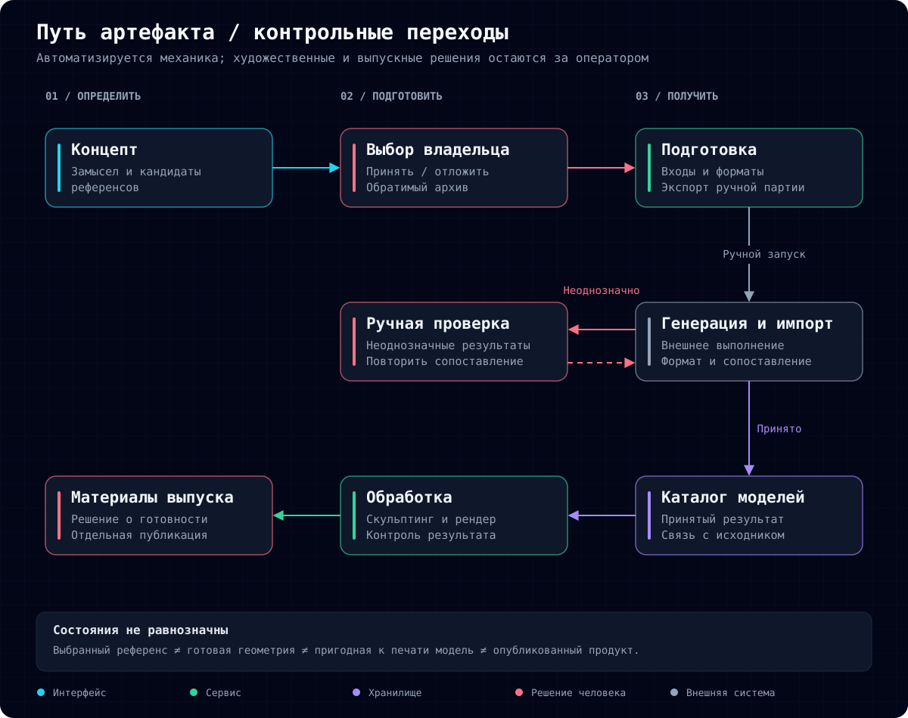
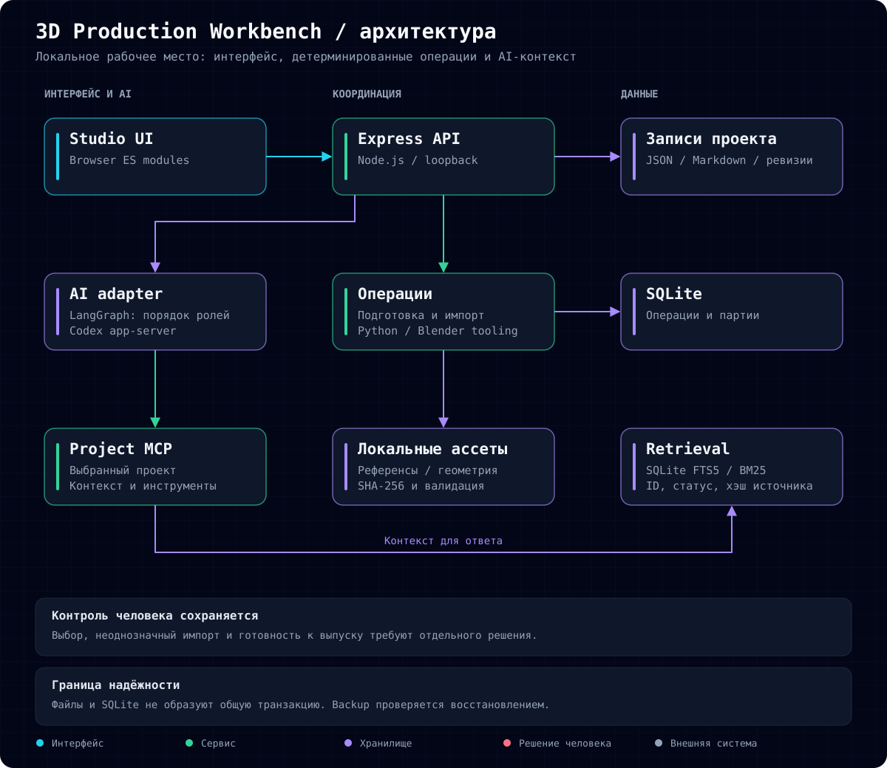
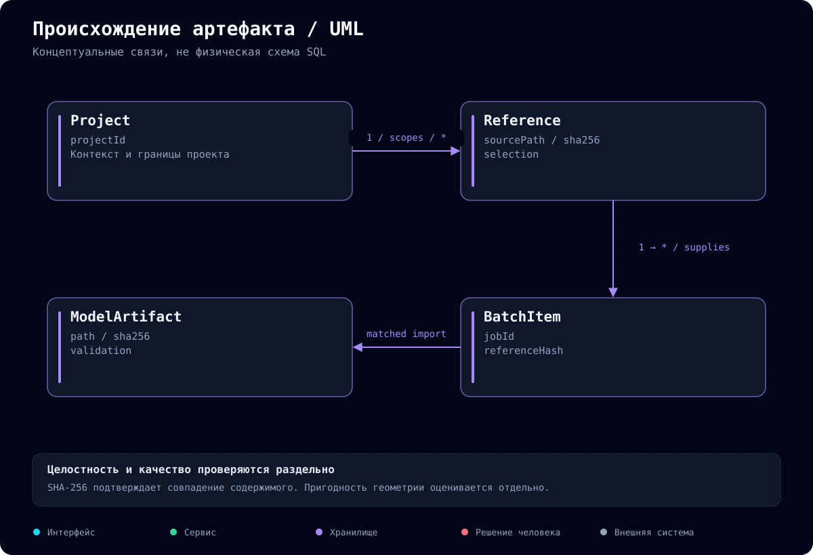

# 3D Production Workbench

Русский · [English](README.en.md)

**Управление производством 3D-коллекции: от идеи и состава набора до подготовленной модели.**

Разрабатываю внутреннее рабочее пространство, которое связывает план коллекции, референсы, партии генерации и результаты импорта. Задача проекта: сделать готовность материалов понятной и сократить необходимость заново восстанавливать контекст при каждом переключении задачи.

Это обезличенный кейс. Рабочие исходники и коммерческие ассеты закрыты. Описание исходного процесса основано на опыте владельца; потери времени пока не измерены.

## Почему понадобились изменения

Производство начиналось до согласования полного состава коллекции. Пока первые модели уже обрабатывались, идеи остальных ещё формировались. Поздние дополнения было сложнее вписать в общий стиль. В конце приходилось выбирать между менее интересными моделями ради объёма набора и исключением уже подготовленной работы.

Распределение по наборам также не всегда определялось заранее. Бесплатный ознакомительный набор, free trial set, выбирался тогда, когда часть производственных решений уже ограничивала выбор. Вместо продуманного знакомства с продуктом приходилось выбирать из доступного.

Проблема была не только в скорости создания геометрии. Переделки возникали из-за поздних решений и неясной готовности входных материалов.

## Где терялось время

Путь от идеи до модели включает определение роли в наборе, подбор визуальных вариантов, согласование стиля и конструкции, подготовку референса к 3D, получение геометрии, сопоставление результата и финальную доработку.

При этом «референс готов» мог означать разные вещи. Один файл был только идеей, другой требовал доработки реалистичности и конструкции, третий уже подходил для передачи на 3D-этап. Пока готовились одни изображения, другие оставались без ясного следующего действия.

**Организационное ограничение:** состав коллекции, художественный выбор и техническая готовность не были достаточно явно разделены. Это затрудняло планирование и заставляло повторно проверять материалы.

## Как построено решение

| Проблема | Изменение процесса | Реализованная поддержка |
| --- | --- | --- |
| Производство опережает общий план | Рассматривать коллекцию целиком и фиксировать решения | Проектные документы и ревизии |
| Идея воспринимается как готовый вход | Разделять выбор и техническую подготовку | Выбор, архивирование, этап подготовки |
| Теряется связь изображения и модели | Сохранять происхождение артефакта | Идентификаторы партий, хэши, сопоставление импорта |
| Неоднозначный результат проходит дальше | Возвращать его на проверку | Ручной разбор и валидация файлов |
| Контекст собирается заново | Хранить документы и материалы в области проекта | Локальное хранение, MCP и поиск |

Раннее закрепление состава наборов, выбор free trial set и контроль полноты коллекции являются следующим продуктовым шагом. Автоматическая оптимизация ассортимента не заявляется как готовая функция.

## Производственный процесс

Приложение автоматизирует подготовку файлов, структуру партий и проверку форматов. Художественный выбор, неоднозначный импорт и готовность к выпуску остаются решениями оператора.

## Техническая реализация

Активный интерфейс использует браузерные ES modules. Сервер построен на Node.js и Express. JSON/Markdown хранят проектные документы, SQLite используется для операций и партий. Python и Blender-инструменты помогают в подготовке и каталогизации. Большие ассеты остаются локальными.

AI поддерживает работу с контекстом, черновиками и рецензированием через Codex, MCP и последовательные роли LangGraph. FTS5/BM25 обеспечивает поиск по документам. Целостность файлов проверяется детерминированным кодом.

Ожидаемая ревизия защищает от перезаписи нового решения устаревшим экраном. SHA-256 подтверждает совпадение содержимого, но не художественную ценность или пригодность модели к печати.

## Результат и оценка

В исходном снимке реализованы проектные записи, ревизии, выбор и архивирование референсов, подготовка партий, каталог и проверки импорта. Промежуточные состояния и связи между материалами представлены явно.

Следующий критерий успеха: меньше возвратов к подготовке и поздних изменений состава коллекции. Для оценки нужно разделять активное время оператора, ожидание внешнего сервиса, повторную работу и полноту набора. Процент ускорения и экономия денег пока не заявляются.

## Моя роль

Постановка производственной задачи, анализ причин переделок, моделирование этапов, проектирование хранения и интеграций, проверка на рабочем процессе. Разработка AI-assisted. Мой вклад: перевод практических проблем в понятные состояния, ограничения и проверяемые действия системы.

**Стек:** Node.js, TypeScript, Express, SQLite, Python, Blender tooling, LangGraph, MCP, FTS5/BM25, browser ES modules.

[Схемы и исходники](docs/diagrams/) · [Профиль разработчика](https://github.com/RassolovSergey)
