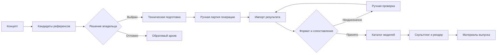
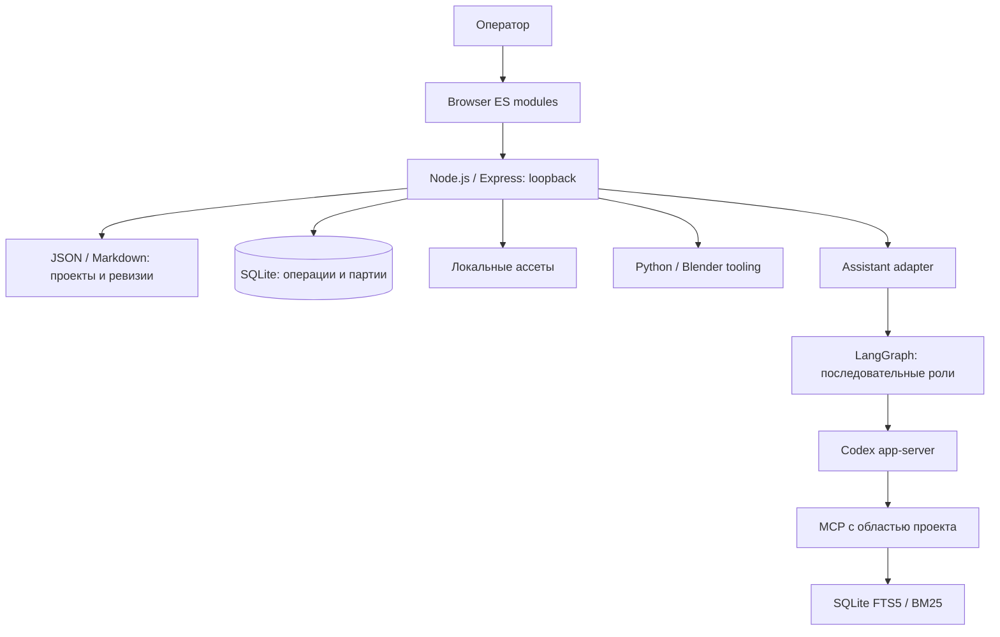
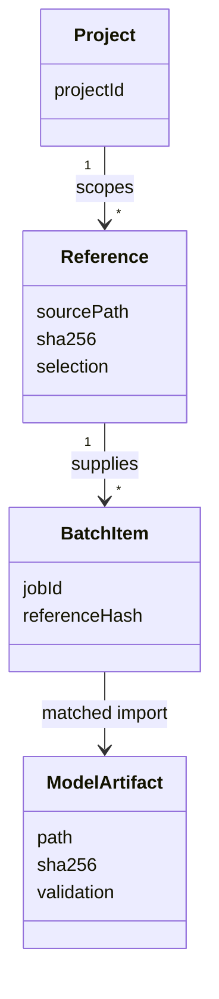

# 3D Production Workbench

### Инженерия производственного процесса: от визуальной гипотезы до прослеживаемого 3D-артефакта

**Workflow engineering · Asset provenance · Human-in-the-loop AI · Local-first systems · MCP / RAG**

Этот кейс описывает внутреннее рабочее пространство для производства цифровых 3D-ассетов. Его задача: сохранить связь между замыслом, выбранным референсом, подготовленным входом, геометрией и итоговым материалом на всём пути между инструментами.

Публичное описание обезличено. Коммерческие модели, документы проектов, аккаунты и рабочий код не публикуются. Архитектура проверена по закрытому исходному снимку; показатели экономии времени пока не измерены.

## Постановка проблемы

Производственная единица: не один файл. Это цепочка решений и версий. Изображение может быть одобрено художественно, но ещё не подготовлено для следующего этапа. Полученная геометрия может соответствовать референсу, но ещё требовать скульптинга и технической проверки. Рендер может быть готов, но не опубликован.

Если эти состояния существуют только в папках и памяти человека, каждое переключение инструментов требует заново восстановить контекст: какой вариант выбран, почему, где его производные и что осталось сделать.

**Рабочая гипотеза:** повторная идентификация файлов, ручная передача контекста и исправление неоднозначных импортов создают устранимые затраты вокруг творческой работы. Утверждение, что именно эти операции занимают большую часть времени, требует хронометража и здесь не делается.

## Как задача превращалась в систему

1. **Разложить процесс на переходы.** Концепт → кандидаты → решение → подготовка → партия → импорт → каталог → обработка → выпуск.
2. **Назвать вход и результат каждого перехода.** Идентификатор проекта, выбранный источник, версия, ожидаемый формат, владелец решения.
3. **Отделить оценку от механики.** Художественный выбор остаётся за человеком; копирование, хэши, структура каталогов и проверка формата автоматизируются.
4. **Сделать промежуточные состояния явными.** Выбор референса не запускает молча публикацию или внешнюю генерацию.
5. **Сохранить возможность возврата.** Архив, ревизии и исходные связи позволяют пересмотреть решение без потери происхождения артефакта.
6. **Определить измерение результата.** Проверять время передачи между этапами, повторные операции и ошибки сопоставления, а не количество внедрённых AI-инструментов.

Это реконструкция инженерной логики по текущему workflow и коду, не датированный журнал исследования с вымышленными экспериментами.

## Процесс и контроль качества

Схема отражает семантические этапы. Она не утверждает, что весь путь исполняется автоматически или имеет единый транзакционный state machine.

## Архитектура

Активный интерфейс использует браузерные ES modules. React/Vite сохранён от предыдущей итерации; его наличие в package.json не делает его текущей архитектурой рабочего экрана. Один workstation-процесс выбран под одного оператора и локальные большие файлы.

### Концептуальная модель происхождения

Это концептуальная UML-модель, а не точное отображение SQL-таблиц. Хэш доказывает совпадение содержимого, но не художественное качество или пригодность модели к печати.

## Почему выбраны такие решения

| Решение | Польза для процесса | Компромисс |
| --- | --- | --- |
| Локальные ассеты + переносимые записи | Файлы доступны существующим инструментам | Нет общей распределённой транзакции |
| SQLite для операций | Долговечные записи без отдельного сервера | Ограничения модели одного рабочего места |
| Проверка ожидаемой ревизии | Устаревший экран не должен молча затирать новое решение | Конфликт требует повторного чтения |
| SHA-256 и валидация импорта | Обнаружение подмены входа и повреждённых файлов | Не заменяет проверку геометрии человеком |
| Ручные партии | Полезный процесс без обещания unattended-доступа к внешней генерации | Некоторые соответствия требуют выбора оператора |
| FTS5/BM25 | Объяснимый поиск по локальным документам | Лексический поиск хуже переносит перефразирование |
| Последовательный LangGraph | Явный порядок автора и рецензентов | Роль проверки фактов не гарантирует истинность; resume после сбоя не заявлен |

## Где AI оправдан

AI используется для черновиков, интерпретации, поиска контекста и рецензирования. Детализация файловых операций, проверка диапазонов GLB, идентификация исходника и шаблонная сборка карточек выполняются детерминированным кодом.

В retrieval индексируются фрагменты с ID документа, статусом и хэшем. Это позволяет обсуждать источник ответа. Следующая проверка качества: набор реальных вопросов с ожидаемыми источниками, включая случаи отсутствующих и устаревших сведений. Само наличие RAG не доказывает точность ответов.

## Результат и границы доказательств

В коде реализованы проектные записи и ревизии, визуальный выбор и архивирование, подготовка партий, каталог, инструменты импорта и локальная AI-интеграция. Защитные проверки охватывают границы путей, контекст проекта и целостность файлов. Полный production throughput и процент экономии не измерены.

Для оценки следующей итерации предлагается фиксировать:

- **Lead time:** время от принятого референса до принятого результата импорта.
- **Touch time:** фактическое время оператора отдельно от ожидания генерации.
- **Rework rate:** доля единиц, повторно вернувшихся на подготовку или сопоставление.
- **Provenance coverage:** доля результатов с подтверждённой связью с исходником.
- **Recovery success:** доля проверочных восстановлений с совпадающими хэшами.

Сравнение проводится на сопоставимых партиях с указанием размера выборки и сложности. Формула оценки рабочего времени: сумма активных операций плюс повторная работа; ожидание внешнего сервиса учитывается отдельно. Значения не подставляются до измерения.

## Авторский вклад

Постановка операционной задачи, моделирование жизненного цикла артефакта, проектирование границ автоматизации, выбор хранения и интеграций, проверка поведения на рабочем процессе. Реализация AI-assisted. Ответственность автора состоит в том, чтобы превращать идеи в проверяемые свойства системы, а не в количестве сгенерированного кода.

**Стек:** Node.js, TypeScript, Express, SQLite, Python, Blender tooling, LangGraph, MCP SDK, SQLite FTS5/BM25, browser ES modules.

[Профиль разработчика](https://github.com/RassolovSergey). Репозиторий содержит инженерное описание; коммерческие ассеты и исходники рабочего приложения остаются закрытыми.
